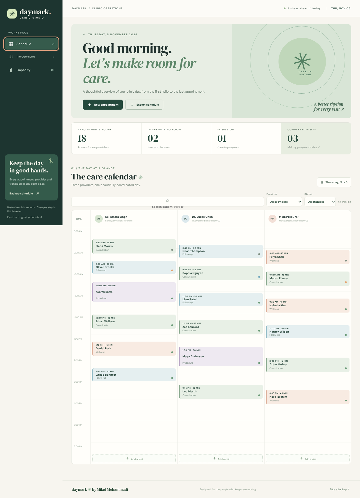
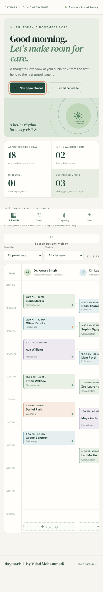

# Daymark

[](https://miladmo68.github.io/daymark-clinic/)    

**[Open the live demo ↗](https://miladmo68.github.io/daymark-clinic/)** · [GitHub source](https://github.com/miladmo68/daymark-clinic)

Daymark is an original clinic scheduling studio for coordinators. It brings a three-provider care calendar, patient handoffs and capacity insights into a calm editorial workspace. The app is designed around the work of moving visits through a day rather than a generic dashboard.

## Mobile



## Features

- Spatial provider calendar with visit cards, time blocks, provider and status filters, search, and a useful empty state.
- Create, edit and remove appointments with working overlap, working-hour and input validation.
- Patient flow for checking in, starting and completing visits, plus a local activity trail.
- Provider workload, appointment mix and care-minute analysis.
- CSV export of the filtered schedule and JSON backup; restore flow with confirmation.
- Keyboard-accessible dialogs, status feedback, reduced-motion support and first-class phone navigation.

## Architecture

React 19, TypeScript and Vite power the frontend. The Node/Express API has Zod request schemas, routes, service-level scheduling rules, structured errors and swappable repositories. A Mongoose model and MongoDB repository are included for a connected deployment. The free GitHub Pages demo uses a deterministic JSON seed with browser persistence so all interactions work without a database or API key. Its example clinic records are illustrative, not real patient information.

## Setup

Node.js 22 or newer:

```sh
npm ci
npm run dev
```

The optional local API uses an in-memory JSON adapter by default. To use the MongoDB adapter, provide your own MongoDB URI:

```sh
npm run start:api
```

Quality checks:

```sh
npm run validate
npm run qa:browser
```

`validate` runs ESLint, TypeScript, backend/domain tests and the production build. `qa:browser` exercises the built app at desktop and phone widths, then writes real screenshots to `public/screenshots/`.

## License

MIT. Source, interface artwork and illustrative records are original to this project. Copyright (c) 2026 Milad Mohammadi.
